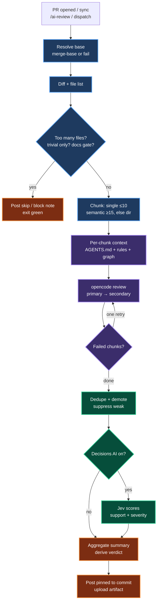
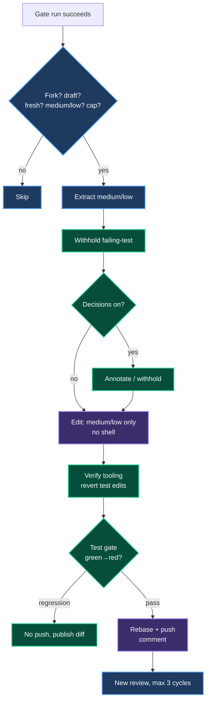

# AI Review Report

Automated PR code review. Each PR is diffed, split into context-aware chunks, reviewed through the [OpenCode](https://opencode.ai/) CLI, and posted back as one structured review. A full review can approve; incremental reviews only comment.

| Skill | What it does |
|---|---|
| **`ai-review-report`** | Generates the review: the CI gate, or `ai-review-report --local`. |
| **`ai-review`** | Reads a posted review, read-only by default; `--fix` applies every recommendation, or `N=fix` / `N=skip` applies selected items. |
| **`ai-analyse`** | Fixes safe Medium/Low findings in CI. Never touches Critical/High or tests by default. |

This page covers the design, how to use it, and the configuration. Each linked doc is authoritative for its area.

## How it works

<p align="center">
  
</p>

Four stages take a PR from diff to posted verdict:

1. **Plan.** Resolve the base, collect the diff, and chunk by shape: one chunk up to 10 files, semantic chunks at 15+, otherwise split by directory.
2. **Review in parallel.** Each chunk gets a focused reviewer with its own context.
3. **Challenge.** Every finding must quote its line; duplicates are merged, weak findings demoted, and an optional decision model scores each one.
4. **Post.** One verdict, pinned to the reviewed commit, with the run artifact uploaded.

Expand either flow for the full diagram.

<details>
<summary><strong>Report pipeline (Mermaid)</strong></summary>



</details>

<details>
<summary><strong>Analyse loop (Mermaid)</strong></summary>



</details>

## Guardrails

- Missing quoted evidence demotes a finding's confidence from ≥75 to 50, never its severity.
- Non-critical findings below 75 confidence, including High, are suppressed. Critical findings keep their severity and can still block.
- A failed chunk fails closed to request-changes, never a silent approve.
- Incremental reviews never approve; only a full review clears a block.
- The fixer never edits tests or evals, and never makes a red test green.
- Every run uploads an artifact: `report.md`, the chunks, merged findings, and metadata.

Each chunk reviewer receives `AGENTS.md`, the scoped rules, graph hints, the blame digest, and your Skip Areas. Each source fails open: when it is missing, its block is omitted and the review continues.

| Review state | Trigger | Outcome |
|---|---|---|
| Full | First review, `/ai-review`, re-request, dispatch | Approve, request-changes, or comment; clears blocks. |
| Incremental | Later pushes | Comment only; skipped while a block stands. |
| Blocked | Docs check failure (when enforced), too many files, trivial skip | Guidance note, no model review. |

## Use as a reusable workflow

This is the default path. Call the workflow from your repository:

```yaml
jobs:
  review:
    uses: generic-automation-and-it/smooth-ai-report-review/.github/workflows/pipeline-code-review-report.yml@v2
    secrets: inherit   # same org only; cross-org callers list the keys explicitly
```

[code-review-caller.yml](docs/examples/code-review-caller.yml) is a ready-made caller with the `model_preset` dropdown and every input documented.

### Recommended: pin the opencode version

Set `OPENCODE_CLI_VERSION` to a `2.x` version. Without a pin, a fresh runner installs whatever upstream currently ships, so the same PR can behave differently over time. The reusable workflow reads the Variable from your repository or organization automatically; nothing needs to be passed through `with:` or `env:`.

## Local-job packaging

If your organization uses `allowed_actions: "selected"` and refuses the cross-org reusable-workflow call, copy [code-review-local.yml](docs/examples/code-review-local.yml) instead. It checks out this repository at a pinned SHA and runs the same `run-review.sh` entrypoint.

This packaging satisfies an allow-list on paper while running the same third-party code the policy is meant to gate, so get security sign-off from your organization or enterprise admin. Prefer the reusable caller whenever the admin can allow `generic-automation-and-it/smooth-ai-report-review@*`.

## Configuration

API keys are GitHub **Secrets**; everything else is a GitHub **Variable**. Only the key for your selected provider must exist.

### Provider and models

| Variable | Set to |
|---|---|
| `OPENCODE_REVIEW_REPORT_PROVIDER` | `OPENAI` (default), `GEMINI`, `COPILOT`, `ANTHROPIC`, `OPENCODE-GO-OPENAI`, `OPENCODE-GO-ANTHROPIC`, `OPENCODE-GO-RESPONSES`, `OPEN_ROUTER` |
| `OPENCODE_REVIEW_REPORT_OPENAI_URL` / `_GEMINI_URL` / `_COPILOT_URL` | Gateway base URL for that provider (required; no default). `ANTHROPIC`, Go, and `OPEN_ROUTER` have hardcoded bases and no URL Variable. |
| `OPENCODE_*_API_KEY` | Selected provider's key (`OPENAI`, `GEMINI`, `ANTHROPIC`, `GO_OPENAI`, `GO_ANTHROPIC`, `OPENROUTER`). Decision scoring reuses the Go or OpenRouter key, so it adds no Secret. |
| `OPENCODE_REVIEW_REPORT_MODEL_PRIMARY` / `_SECONDARY` / `_ORCHESTRATOR` | `gpt-5.6-sol` / `gpt-5.5` / `gpt-5.6-terra`. Non-OpenAI providers must set all three. `model_preset` overrides all three. |
| `OPENCODE_CLI_VERSION` | Pin `2.x`. Blank means reuse any v2, otherwise install the latest. |

### Review scope and gates

| Variable | Set to |
|---|---|
| `OPENCODE_REVIEW_REPORT_MAX_FILE_COUNT` | `100`. Above it: request-changes and skip. Per-run: `--file-limit` / `file_limit`. |
| `OPENCODE_REVIEW_REPORT_RUN_ON_DRAFT` / `OPENCODE_ANALYSE_RUN_ON_DRAFT` | `false`. Truthy reviews or auto-fixes drafts. Separate knobs on purpose. |
| `OPENCODE_REVIEW_REPORT_DISABLE_AGENTS_MD_CHECK` | `1` (check off; set `0` to enforce). When off, the review notes that keeping AI agent contextual knowledge current is still good practice. |
| `OPENCODE_REVIEW_REPORT_SUMMARY_TIMEOUT` | `600`. Total budget (seconds) for the aggregation summary call, split between the orchestrator and the review-model fallback. A timeout follows the summary-failure path and can never make a review greener; non-integers fall back to `600`. |

### Graph and decisions

| Variable | Set to |
|---|---|
| `OPENCODE_REVIEW_REPORT_ENABLE_GRAPH_ANALYSIS` / `OPENCODE_REVIEW_REPORT_GRAPH_SIGNALS` / `OPENCODE_REVIEW_REPORT_GRAPH_SIGNALS_MAX_BYTES` | `1` / `1` / `1024`. Graph analysis plus risk and coverage hints in each chunk prompt. Falsy disables; the byte cap bounds each slice. |
| `OPENCODE_REVIEW_REPORT_ENABLE_DECISIONS` + `_DECISIONS_*` | `0` (off). `annotate` shows scores; `filter` suppresses non-critical findings below the threshold, with full coverage required. |

### Fixer (`ai-analyse`)

| Variable | Set to |
|---|---|
| `OPENCODE_ANALYSE_ALLOW_TEST_SELF_FIX` | Off. Truthy lets the fixer edit tests; evals stay off-limits always. |
| `OPENCODE_ANALYSE_MAX_INCREMENTAL` | `3`. Auto-fix cycles per full-review epoch. |
| `OPENCODE_ANALYSE_TEST_COMMAND` / `_TIMEOUT` | Unset command means auto-detect tracked test suites; no suites means skip verification. Auto-detected suites use regression-relative gating (green→red blocks); an explicit command must pass. Timeout is the whole-gate budget in seconds (default `600`); timeouts always block. |

Full reference: [SKILL.md](.agents/skills/ai-review-report/SKILL.md), [caller](docs/examples/code-review-caller.yml), [local-job](docs/examples/code-review-local.yml).

Install the skills with `scripts/install-skills.sh` (the core pair, `ai-review` and `git-commit-review-push`), adding `-a` for `ai-review-report` and `ai-analyse`. The Claude Code marketplace offers the same split: `smooth-ai-review` plus optional `smooth-ai-review-report` and `smooth-ai-analyse`.

## Docs

| Doc | Read for |
|---|---|
| [ai-review-report SKILL.md](.agents/skills/ai-review-report/SKILL.md) | Runtime contract: full env vars, switches, chunk/merge/decision behavior |
| [ai-review-report AGENTS.md](.agents/skills/ai-review-report/AGENTS.md) | LADRs: why each pipeline decision exists |
| [ai-review SKILL.md](.agents/skills/ai-review/SKILL.md) | `/ai-review` analyse + execute, fix/skip table, Copilot vs other routing |
| [ai-analyse SKILL.md](.agents/skills/ai-analyse/SKILL.md) | Fixer contract: scope, guardrails, decision lines, test gate |
| [ai-analyse AGENTS.md](.agents/skills/ai-analyse/AGENTS.md) | Fixer LADRs and enforcement notes |
| [pipeline-code-review-report.yml](.github/workflows/pipeline-code-review-report.yml) | Gate triggers, `model_preset`, reusable `workflow_call` inputs |
| [pipeline-ai-analyse.yml](.github/workflows/pipeline-ai-analyse.yml) | Fixer guard, push rules, test gate, run artifacts |
| [code-review-caller.yml](docs/examples/code-review-caller.yml) | Copy-paste reusable caller |
| [code-review-local.yml](docs/examples/code-review-local.yml) | Allow-list local-job caller (pinned SHA) |
| [install-skills.sh](scripts/install-skills.sh) + [SKILLS_INSTALLER.md](scripts/SKILLS_INSTALLER.md) | Skills installer contract |
| [AGENTS.md](AGENTS.md) | Repo contract: path coupling, credential rules, consumption modes |
| [CHANGELOG](.agents/skills/ai-review-report/references/CHANGELOG.md) | Dated audit trail |
