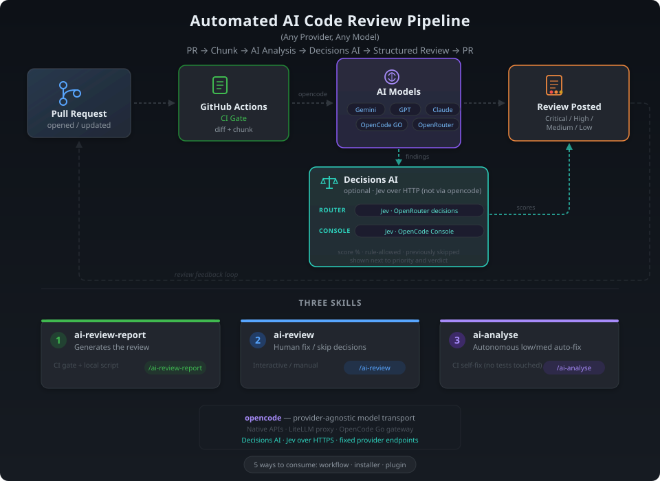
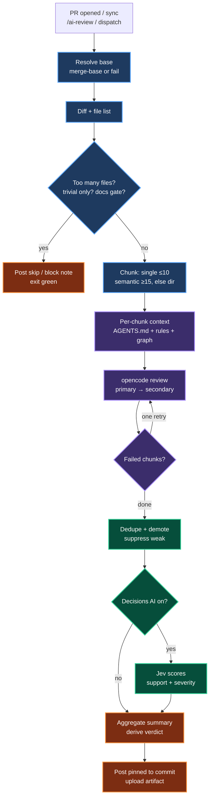
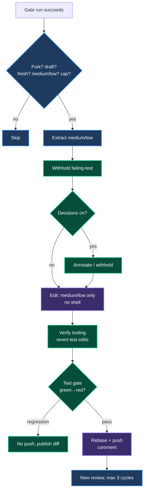

# AI Review Report

Automated PR code review. Diffs each PR, splits it into context-aware chunks, reviews them through the [OpenCode](https://opencode.ai/) CLI, posts one structured review. Full reviews can approve; incremental reviews only comment.

| Skill | Job |
|---|---|
| **`ai-review-report`** | Generates the review (CI gate + `ai-review-report --local`). |
| **`ai-review`** | Consumes a posted review (`/ai-review <pr>` analyse, `/ai-review <pr> 1=fix …` execute). |
| **`ai-analyse`** | Autonomous fixer: safe Medium/Low edits in CI. Never touches Critical/High or tests by default. |

Details live in the linked docs below — this page is the overview, the design, and the knobs.

## Design

  

Inspired by [PR-AF's dynamic pipeline architecture](https://github.com/Agent-Field/pr-af#dynamic-pipeline-architecture) — the plan comes from the PR's shape, not a fixed checklist:

- **Plan:** diff → gates → chunk by shape (single ≤10, semantic ≥15, else dir).
- **Parallel:** one focused reviewer per chunk with its own context.
- **Challenge:** quote-the-line, dedupe, demote weak, optional Jev judge.
- **Post:** one verdict, pinned to the commit, artifact uploaded.

Both flows expand as Mermaid.

<strong>Report pipeline (Mermaid)</strong>

<strong>Analyse loop (Mermaid)</strong>

Why it stays accurate:

- Every Critical/High must quote its `file:line` or drop to Low.
- Failed chunks fail closed to request-changes, never silent approve.
- Incremental reviews never approve — only full reviews clear a block.
- Fixer never edits tests/evals and never makes a red test green.
- Every run uploads an artifact (`report.md`, chunks, merged findings, metadata).

Per chunk the reviewer gets: `AGENTS.md`, scoped rules, graph hints, blame digest, your Skip Areas. All fail open — missing source omits its block, never blocks the review.

| Review state | Trigger | Outcome |
|---|---|---|
| Full | First review, `/ai-review`, re-request, dispatch | Approve, request-changes, or comment. Clears blocks. |
| Incremental | Later pushes | Comment only. Skipped while a block stands. |
| Blocked | Docs check fail, too many files, trivial skip | Guidance note, no model review. |

## Config

Keys are **Secrets**, rest is **Variables**. Only the selected provider's key must exist.

| Variable | Set to |
|---|---|
| `OPENCODE_REVIEW_REPORT_PROVIDER` | `OPENAI` (default), `GEMINI`, `COPILOT`, `ANTHROPIC`, `OPENCODE-GO-OPENAI`, `OPENCODE-GO-ANTHROPIC`, `OPENCODE-GO-RESPONSES`, `OPEN_ROUTER` |
| `OPENCODE_REVIEW_REPORT_OPENAI_URL` / `_GEMINI_URL` / `_COPILOT_URL` | Gateway base URL for that provider (required; no default). `ANTHROPIC`, Go, `OPEN_ROUTER` have hardcoded bases — no URL var. |
| `OPENCODE_*_API_KEY` | Selected provider's key (`OPENAI`, `GEMINI`, `ANTHROPIC`, `GO_OPENAI`, `GO_ANTHROPIC`, `OPENROUTER`). Decision scoring reuses the Go/OpenRouter key — no new secret. |
| `OPENCODE_REVIEW_REPORT_MODEL_PRIMARY` / `_SECONDARY` / `_ORCHESTRATOR` | `gpt-5.6-sol` / `gpt-5.5` / `gpt-5.6-terra`. Non-OpenAI must set all three. `model_preset` overrides all three. |
| `OPENCODE_CLI_VERSION` | Pin `2.x`. Blank = reuse any v2, else install latest. |
| `OPENCODE_REVIEW_REPORT_MAX_FILE_COUNT` | `100`. Over it: request-changes + skip. Per-run: `--file-limit` / `file_limit`. |
| `OPENCODE_REVIEW_REPORT_RUN_ON_DRAFT` / `OPENCODE_ANALYSE_RUN_ON_DRAFT` | `false`. Truthy reviews / auto-fixes drafts. Separate knobs on purpose. |
| `OPENCODE_REVIEW_REPORT_ENABLE_GRAPH_ANALYSIS` / `_GRAPH_SIGNALS` | `1` / `1`. Graph hints (risk + coverage) in each chunk prompt. Falsy disables. |
| `OPENCODE_REVIEW_REPORT_ENABLE_DECISIONS` + `_DECISIONS_*` | `0` (off). `annotate` shows scores; `filter` suppresses non-critical below threshold, full coverage only. |
| `OPENCODE_ANALYSE_ALLOW_TEST_SELF_FIX` | Off. Truthy lets the fixer edit tests; evals stay off-limits always. |
| `OPENCODE_ANALYSE_MAX_INCREMENTAL` | `3`. Auto-fix cycles per full-review epoch. |
| `OPENCODE_REVIEW_REPORT_DISABLE_AGENTS_MD_CHECK` | `1` (check off; set `0` to enforce). When off, the review notes that keeping AI agent contextual knowledge current is still good practice. |
| `OPENCODE_ANALYSE_TEST_COMMAND` / `_TIMEOUT` | Unset = skip verification. Regression-relative: only green→red blocks. |

Full reference: [SKILL.md](.agents/skills/ai-review-report/SKILL.md), [caller](.docs/examples/code-review-caller.yml), [local-job](.docs/examples/code-review-local.yml).

Install: reusable caller (default), local-job caller (allow-list), `scripts/install-skills.sh -a` (skills), marketplace plugin (Claude Code).

## Docs

| Doc | Read for |
|---|---|
| [ai-review-report SKILL.md](.agents/skills/ai-review-report/SKILL.md) | Runtime contract: full env vars, switches, chunk/merge/decision behavior |
| [ai-review-report AGENTS.md](.agents/skills/ai-review-report/AGENTS.md) | LADRs: why each pipeline decision exists |
| [ai-review SKILL.md](.agents/skills/ai-review/SKILL.md) | `/ai-review` analyse + execute, fix/skip table, Copilot vs other routing |
| [ai-analyse SKILL.md](.agents/skills/ai-analyse/SKILL.md) | Fixer contract: scope, guardrails, decision lines, test gate |
| [ai-analyse AGENTS.md](.agents/skills/ai-analyse/AGENTS.md) | Fixer LADRs and enforcement notes |
| [pipeline-code-review-report.yml](.github/workflows/pipeline-code-review-report.yml) | Gate triggers, `model_preset`, reusable `workflow_call` inputs |
| [pipeline-ai-analyse.yml](.github/workflows/pipeline-ai-analyse.yml) | Fixer guard, push rules, test gate, run artifacts |
| [code-review-caller.yml](.docs/examples/code-review-caller.yml) | Copy-paste reusable caller |
| [code-review-local.yml](.docs/examples/code-review-local.yml) | Allow-list local-job caller (pinned SHA) |
| [install-skills.sh](scripts/install-skills.sh) + [SKILLS_INSTALLER.md](scripts/SKILLS_INSTALLER.md) | Skills installer contract |
| [AGENTS.md](AGENTS.md) | Repo contract: path coupling, credential rules, consumption modes |
| [CHANGELOG](.agents/skills/ai-review-report/references/CHANGELOG.md) | Dated audit trail |
