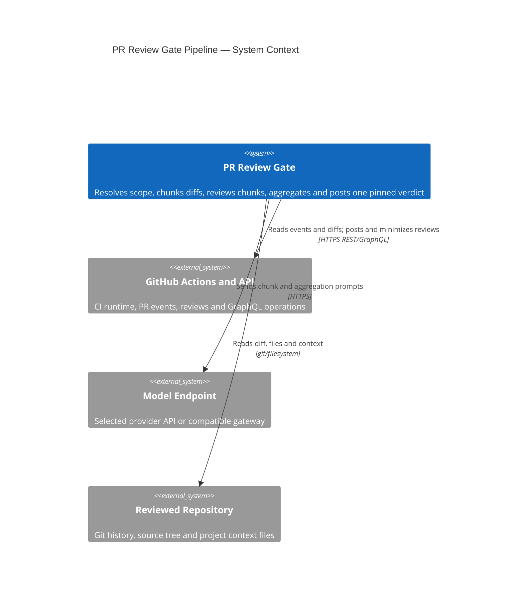
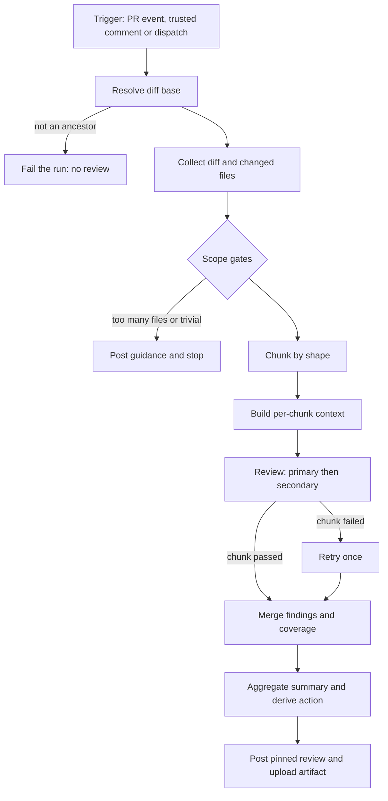

# Diagrams — PR Review Gate Pipeline

The C1 is the mandatory floor. The flow below earns its place because the gate's safety comes from
its decision path, which C1 cannot show.

## System Context (C1)

The gate runs on GitHub-hosted runners, reads the reviewed repository and its history, sends prompts
to the selected provider endpoint, and posts reviews back to GitHub.

## Gate Flow

One review path: prove scope, bound the work, survive failure, then post a pinned verdict.

