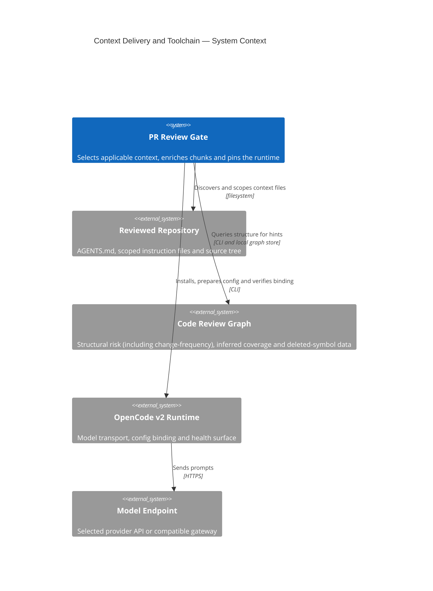
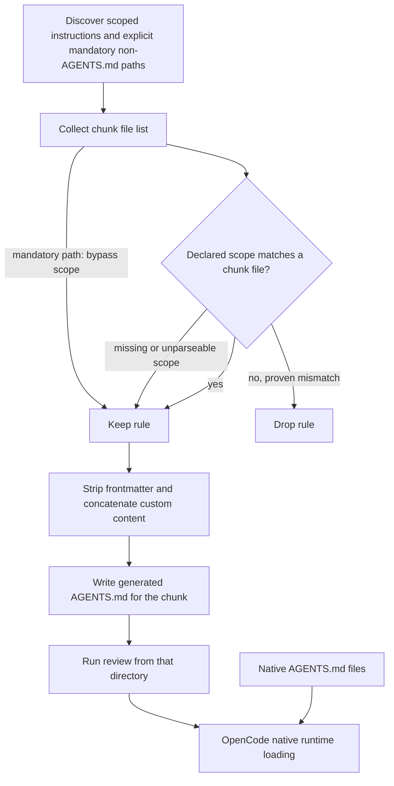

# Diagrams — Context Delivery and Toolchain

The C1 is the mandatory floor. The flow below earns its place because the fail-open selection rule
is the design's load-bearing behavior and is not visible in a context diagram.

## System Context (C1)

The gate discovers context in the reviewed repository, queries the code graph when available, and
runs on a pinned OpenCode v2 runtime that reaches the selected model endpoint.

## Context Selection Flow

Custom candidates are filtered by their own declared scope; every uncertain case survives.
Native `AGENTS.md` files stay on OpenCode's runtime discovery path and are never concatenated.

