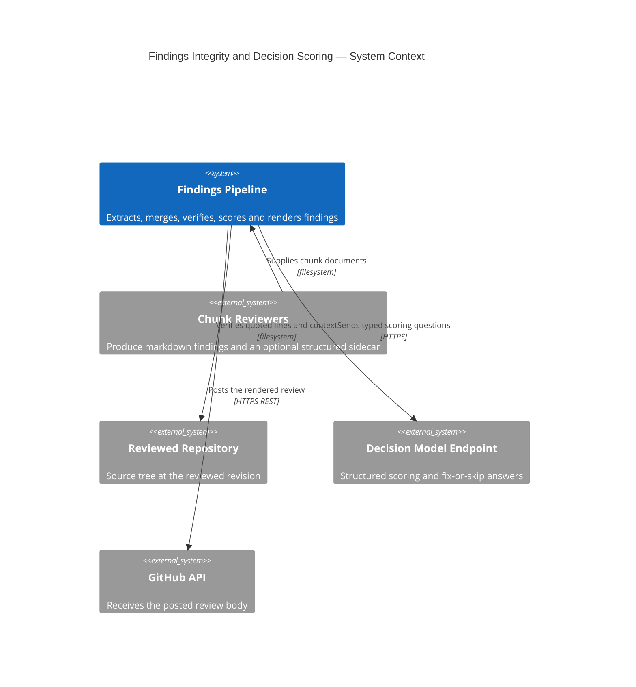
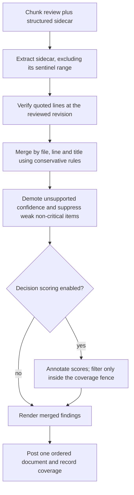

# Diagrams — Findings Integrity and Decision Scoring

The C1 is the mandatory floor. The flow below earns its place because the ordering of extraction,
merge, judgement and rendering is what keeps every consumer stable.

## System Context (C1)

The pipeline receives chunk reviews and their structured sidecars, verifies quotes against the
reviewed tree, optionally calls a decision endpoint, and renders the document that is posted.

## Finding Lifecycle

Each claim is extracted once, merged conservatively, optionally judged, then rendered for every
consumer from one ordered document.

