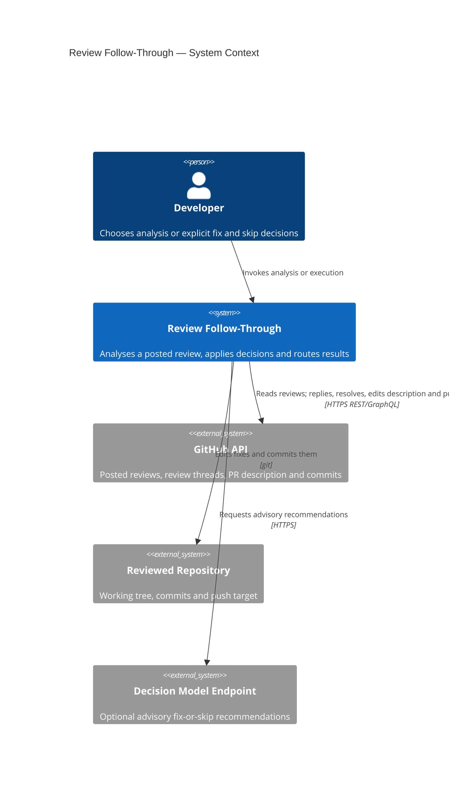
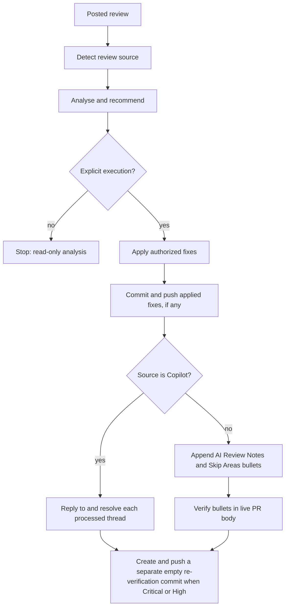

# Diagrams — Review Follow-Through

The C1 is the mandatory floor. The flow below earns its place because the routing split between
Copilot threads and PR-description notes decides where every result lands.

## System Context (C1)

A developer runs the consumer against a posted review. The consumer reads and writes GitHub state,
edits the local checkout, and pushes commits that carry the next review trigger.

## Follow-Through Flow

Analysis is the default; execution is explicit. The source decides the routing channel, and the
final commit hands control back to the gate.

