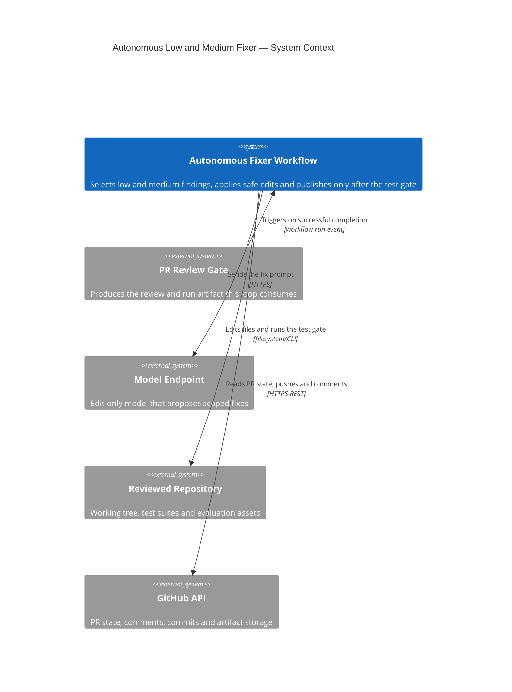
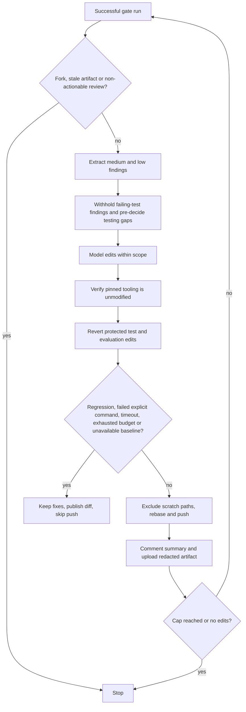

# Diagrams — Autonomous Low and Medium Fixer

The C1 is the mandatory floor. The flow below earns its place because the safety of the loop comes
from where each filter and gate runs, not from the components alone.

## System Context (C1)

The fixer runs as a workflow after a successful gate run, reads the gate's artifact and the PR, uses
a model for scoped edits, and relies on the repository's test suites as an independent oracle.

## Fixer Loop

Each cycle narrows the findings, protects the oracle, and publishes only what the gate approved.
Auto-detected suites gate on regressions; explicit test commands gate on any nonzero exit.
Timeouts, exhausted budgets and unavailable baselines fail closed.

