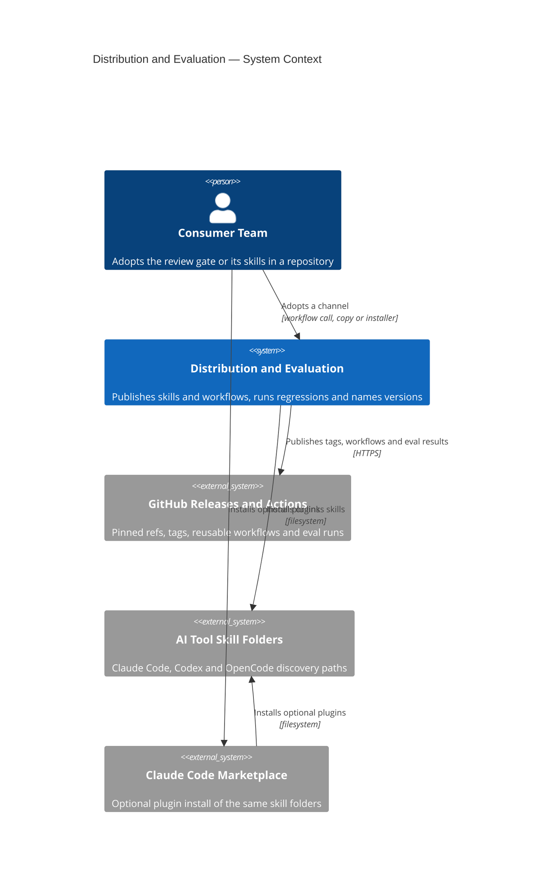
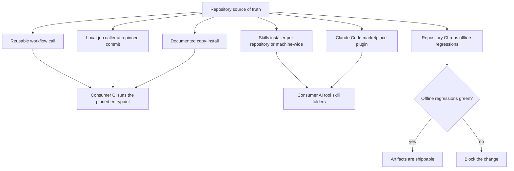

# Diagrams — Distribution and Evaluation

The C1 is the mandatory floor. The flow below earns its place because the same source reaches
consumers through five different channels, and which channel a team uses determines its pin.

## System Context (C1)

Consumers reach this repository through a workflow call, a local-job copy, an installer, a
marketplace, or a documented copy-install. Evaluation runs inside this repository's CI against the
same artifacts.

## Delivery Channels

Every channel resolves the same artifacts; only the pin and the placement differ.

