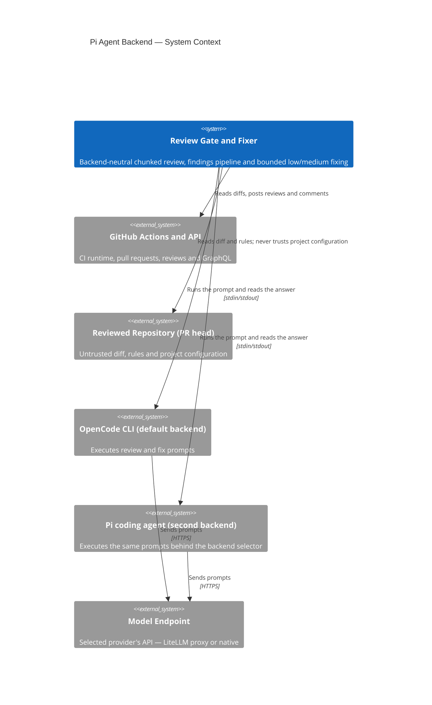

# Diagrams — Pi Agent Backend

The **C1 System Context** below is the mandatory floor for every HLD. Additional diagrams are
deferred until the contract is approved; the candidate is a dispatch/lockdown flow, which earns a
place only if the per-role tool contract proves hard to read from the goals and LADRs alone.

## System Context (C1)

The gate is one backend-neutral pipeline. It reads a pull request, builds a scoped instruction set,
runs a selected runtime, and owns every side effect. The runtime is a replaceable external
dependency; the reviewed repository is untrusted input, not configuration.

