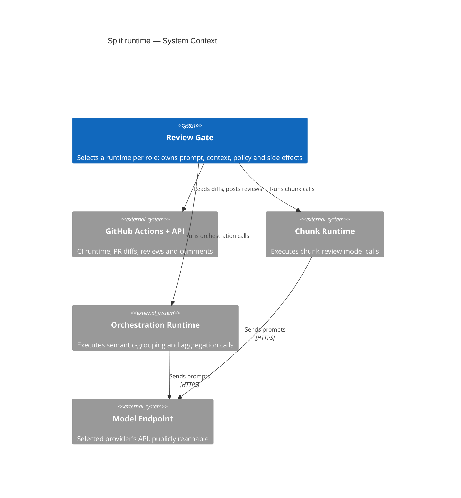
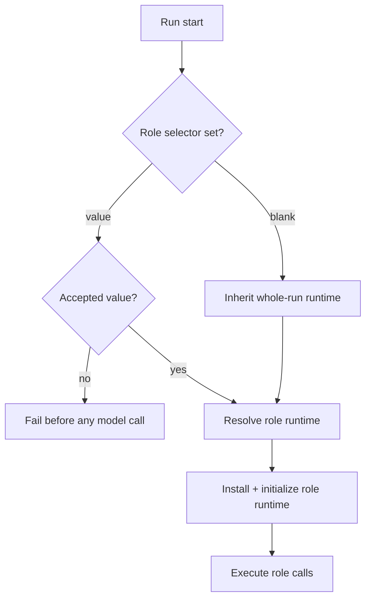

# Diagrams — Split runtime — pi chunk review, OpenCode orchestration

## System Context (C1)

The gate is one system with two model-execution roles: chunk review and orchestration. Each role resolves
a runtime from its selector; both runtimes reach the selected provider endpoint. GitHub supplies the diff,
PR metadata and side effects; the evaluation harness observes both runtimes report-only.

## Routing flow (Flow)

The role resolver is the only place a runtime is chosen; both roles share the resolver's failure
behaviour, and a rejected selector fails before any runtime starts.

