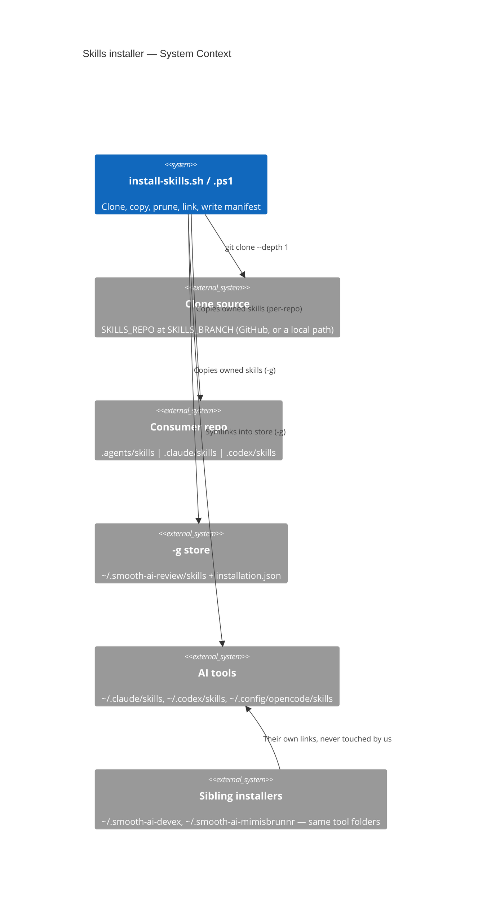

# scripts/

## TL;DR

One-command skills installers (`install-skills.sh` / `install-skills.ps1`) that put this repo's review skills into a consumer repo, or with `-g` once per machine linked into Claude Code, Codex and OpenCode — two ports of one contract, skills only, never touching another installer's state. Operator contract: [`SKILLS_INSTALLER.md`](SKILLS_INSTALLER.md); decision record: LADR-108 in `.agents/skills/ai-review-report/AGENTS.md`.

## Non-Negotiables

- **Two ports, one contract.** Every behaviour change goes into `install-skills.sh` **and** `install-skills.ps1` in the same commit, with a case in `test-install-skills.sh`. The owned lists (`OWNED_CORE` / `OWNED_OPTIONAL`, `$OwnedCore` / `$OwnedOptional`) must stay identical — the harness compares them byte-for-byte after normalisation.
- **`ai-review-report` and `ai-analyse` stay behind `-a`.** A per-repo `.agents/skills/ai-review-report` makes the reusable gate and the analyse workflow run that copy instead of their pinned tooling, so it must never be installed by default.
- **Own state, never a sibling's.** Store `~/.smooth-ai-review`, per-repo state `_smooth-ai-review-shared/`. Purge only links whose target is under our store; a real folder or a link elsewhere is never touched.
- **Corrupt manifest = hard error; manifest written last.** Empty, whitespace-only, unparseable or non-object JSON fails the run and is left as is — never reset flags from defaults.
- **Skills only — no tool config edits.** This repo owns no rules or hooks, so neither port reads or writes `~/.codex/AGENTS.md`, `hooks.json` or `opencode.json`. Owning one means porting smooth-ai-product-context-memory's config-edit machinery (own markers, snapshots, uninstall that removes only its own entries), not improvising it.
- **Profile edits are the one exception to "no config edits".** `write_decisions_env` / `Write-DecisionsEnv` appends `SMOOTH_REPORT_DECISIONS_*` to the shell profile with a backup snapshot; in global mode a `profile-edit` link record tracks the edit so `--uninstall` restores from the snapshot or strips the marker-guarded block. The comment-line sentinel is `Smooth AI Report Review` + `Decision Validation`.
- **The bash port stays bash 3.2-safe** (`/bin/bash` on macOS): no `${v,,}`, `mapfile` or associative arrays; `"${arr[@]+…}"` for possibly-empty arrays under `set -u`.

## System Context

A run clones this repo (or `SKILLS_REPO`) shallowly, copies the owned skills into the consumer's skills folder or the `-g` store, and — for `-g` — symlinks them into each AI tool whose config folder already exists. The only state is one JSON manifest per install.

## Key Behaviors

- **The optional pair joins the manifest as `installed: false`** on a first run without `-a`; `-a` flips them to `true` and they stay on for later runs. An operator's `false` on a core skill is kept, and the skill is no longer refreshed (local edits survive).
- **A symlink at a per-repo skill path is replaced by a real copy** (the retired npm plugin linked skills into `.agents/skills`); `rm -f` on the link, never `rm -rf` through it, so the target survives.
- **The gate-precedence warning keys on the literal reusable-workflow `uses:` path** in `.github/workflows/*.y*ml` and fires only when `ai-review-report` landed in `.agents/skills` — the only path the gate's `[ -f ]` check looks at.
- **The skills ship no symlinks; a copy is plain `cp -R` / `Copy-Item -Recurse`.** Adding one needs the sibling installers' link materialisation first; the harness fails until then.
- **Pruning is a runtime list:** skill `AGENTS.md`, `test-*`, `tests/`, `run-regressions.sh`, `requirements-test.txt`, `scripts/eval/`, `__pycache__/`. Any runtime file named `test-*` would be silently dropped — the harness checks every `lib/` path an installed script names still exists.
- **A credential-bearing `SKILLS_REPO` is refused before logging or cloning** (`reject_credential_url` / `Assert-NoCredentialUrl`): any userinfo on http(s)/ftp(s), or `user:pass@` elsewhere; `ssh://git@host` passes. The error never echoes the URL — git argv is visible to other processes.
- **Loops over manifest names skip the empty line** (`|| continue`): with every skill off, `<<<` still yields one empty line.
- **`enabled` on a link record is a status, not a control** — recomputed every `-g` run; `harnesses.<tool>: false` is the control.
- **`ai-review --usedecisions` resolves `../../ai-review-report` through the tool folder**, so under `-g` it works only when `-a` linked the sibling; `local-review.sh` under `-g` reviews the cwd's work tree (`lib/resolve-repo-root.sh`).
- **Link targets must compare as identical strings across ports** (`$GLB_ROOT/skills/<name>` vs `Join-Path`); a trailing slash on `SMOOTH_AI_REVIEW_HOME` is stripped, or the on-disk purge would miss links.
- **`-d` is sticky.** Once set, `decisions_enabled: true` is saved in the manifest and reused on later runs without `-d`. The env block is always written (with `ENABLED=false` by default) so the vars are discoverable. Only the `ENABLED` line is updated when `-d` flips the value; the rest of the block is never duplicated.

## Test References

| Tier | Path | Covers |
|---|---|---|
| L0 | `test-install-skills.sh` | both ports per-repo and `-g`: ownership, manifest reconcile/corruption, root search, pruning, link replacement, gate warning, harness flags, uninstall, decisions env vars (`-d`, sticky, idempotent, profile write/strip, manifest field), cross-port parity, `lib/resolve-repo-root.sh` |

Registered in the blocking `opencode-v2-regressions` array in `.github/workflows/llm-eval-harness.yml`; `.agents/skills/ai-review-report/scripts/run-regressions.sh` runs the same list locally. `.ps1` and parity cases skip with a stated reason when `pwsh` is absent (as on `ubuntu-latest`).

## Changelog

| Date | Change | Ref |
|------|--------|-----|
| 2026-10-21 | Created with the skills installers; npm channel removed. | LADR-108 |
| 2026-10-21 | Credential-URL refusal, explicit empty-name skip, all-skills-off and credential cases in the harness (PR review). | LADR-108 |
| 2026-10-22 | `-d` flag and `SMOOTH_REPORT_DECISIONS_*` profile write; `backup_inplace`, `profile-edit` link records, uninstall strip; manifest `decisions_enabled` field; test cases for both ports. | — |
